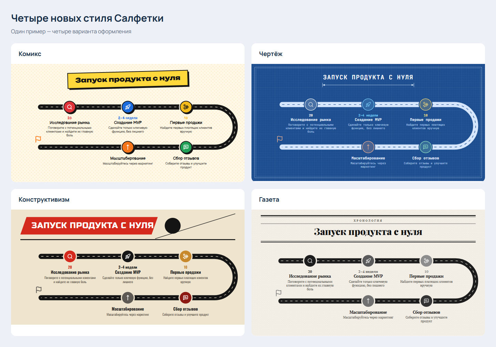
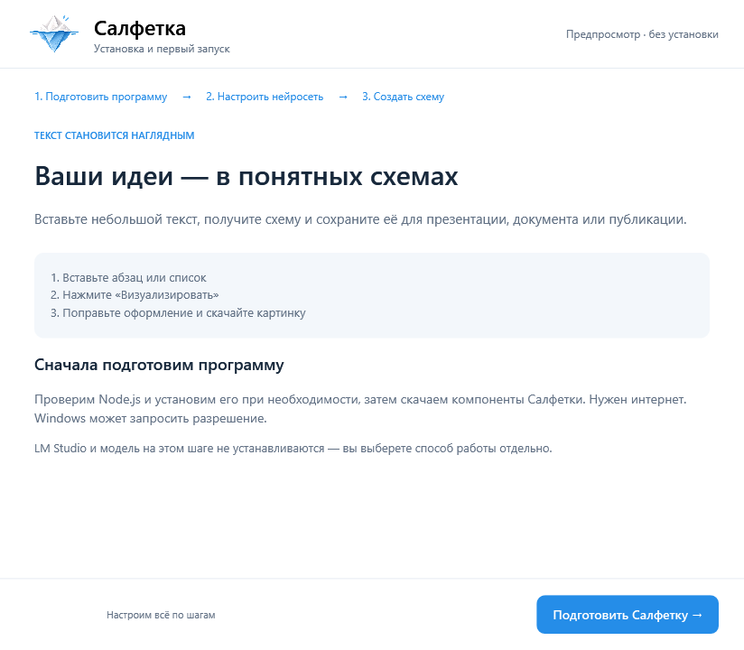
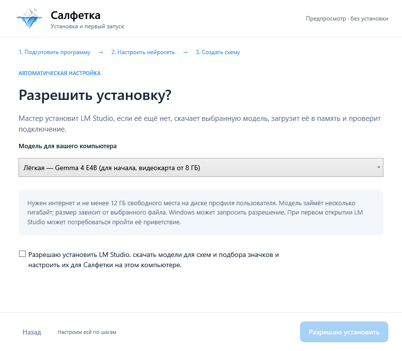

# Салфетка 1.2.0 — новые стили и понятная установка

Текст можно превратить в схему, поправить оформление и сохранить результат для презентации, документа или публикации.

## Что скачать

- **Salfetka-Setup-1.2.0.exe** — обычная установка для Windows 10/11. Это основной вариант: скачайте файл, запустите и следуйте подсказкам.
- **Salfetka-1.2.0-source.zip** — программа и исходники для ручного запуска и разработки. Готового окружения Node.js и моделей в архиве нет.
- **SHA256SUMS.txt** — контрольные суммы файлов выпуска.

## Новое оформление

- Четыре новых стиля: **Комикс**, **Чертёж**, **Конструктивизм** и **Газета**. Всего доступно 12 стилей.
- Крупные превью показывают вашу схему целиком в каждом стиле.
- Палитра, настройки шрифта и фон собраны во вкладке **«Дополнительно»**. У особых стилей — собственная гамма.
- Доработаны формы: кольцо цикла не просвечивает сквозь узлы; весы наклонены; подписи диалога и иерархии точнее подстраиваются под текст.

## Установить стало проще

Программа уже находится внутри установщика: скачивать исходники с GitHub вручную не нужно. После копирования файлов открывается графический мастер с логотипом Салфетки.

1. Мастер проверит Node.js и подготовит необходимые компоненты. Для этого нужен интернет.
2. Выберите **«Через интернет»** с OpenRouter или **«На компьютере»** с LM Studio.
3. При работе на компьютере можно настроить LM Studio самостоятельно или поручить это мастеру.
4. **Автоматическая установка LM Studio и загрузка моделей начинаются только после отдельного согласия.**
5. Мастер проверит подключение и подскажет, как создать первую схему.

При ошибке можно открыть журнал, повторить попытку или выбрать другой способ работы. Текущую настройку можно остановить. Ярлык на рабочем столе вернёт в мастер, если настройка ещё не закончена.

## Перед первым запуском

- В самой Салфетке регистрация не нужна. Для работы через OpenRouter понадобится отдельный аккаунт и ключ; у бесплатных моделей есть ограничения.
- В режиме LM Studio текст обрабатывается на вашем компьютере. В облачном режиме текст отправляется OpenRouter и выбранному поставщику модели.
- Для установки компонентов и загрузки моделей нужен интернет; модели могут занимать несколько гигабайт. Права администратора для самой Салфетки не нужны, но дополнительные компоненты могут вызвать запрос Windows.
- Установщик не подписан цифровой подписью. Скачивайте его со страницы этого выпуска и проверяйте имя издателя и источник файла.
- Установка из пакета не включает автоматическое обновление через Git. Новую версию можно поставить новым установщиком.

## Проверки и приватность

Проверены типы, сборка приложения и установщика, экраны мастера, блокировка установки без согласия и сохранение режима работы. Полный цикл автоматической установки на чистой Windows пока не проверен.

Установщик собирается по явному списку файлов программы. Личные настройки `.env`, ключи, журналы, рабочие папки и посторонние изображения не включены. Скриншоты подготовлены на демонстрационном тексте без личных документов и данных профиля.
