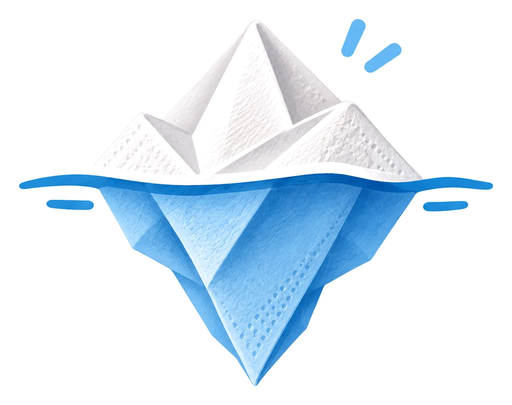
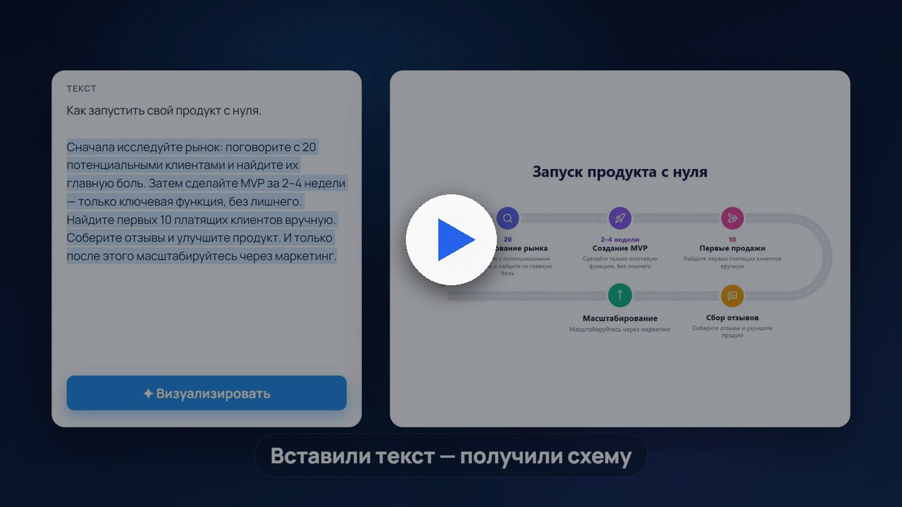

<div align="center">

<picture>
  <source media="(prefers-color-scheme: dark)" srcset="apps/web/public/brand/logo-dark.png">
  
</picture>

# Салфетка

**Превращает текст в инфографику и схемы бизнес-процессов.**<br>
Бесплатно, на вашей видеокарте или в облаке, без подписок и регистрации.

[](LICENSE)


[](https://t.me/ii_eggs)

<a href="https://youtu.be/qyC6QuKjn84"></a><br>
<sub>▶ Смотреть демонстрацию на YouTube (40 секунд)</sub>

[Что умеет](#что-умеет) · [Установка](#установка) · [Без видеокарты](#без-видеокарты--openrouter) · [Обновления](#обновления) · [Конфиденциальность](#конфиденциальность) · [Лицензия](#лицензия)

</div>

---

## Что умеет

Вставляете текст, выделяете абзац или список и нажимаете «Визуализировать». Нейросеть разбирает текст и предлагает
подходящие формы, а Салфетка рисует готовую схему. Её можно сразу поправить и скачать.

### Схемы

- **43 формы в 11 категориях**: процесс, хронология, сравнение, данные, иерархия, части целого, идеи и рассказ,
  причины и решения, бизнес-фреймворки, визуальные метафоры, тексты и люди.
  Среди них есть айсберг, мишень, спидометр, пьедестал, весы, горы с флагом, храм, мост, ракета, дорожная карта,
  рыбья кость, SWOT, PESTEL, оргструктура, персона и FAQ.
- **8 стилей**: Плоский, Набросок (от руки), Контур, Пастель, Бизнес, Доска (мел), Премиум и Премиум · ночь.
  Стиль можно сочетать с любой из **10 палитр**.
- **Фон**: 8 готовых вариантов (белый, бумага, графит, ночь…) или свой цвет. Текст сам подстраивается под тёмный фон.
- **Иконки по смыслу**: Салфетка подбирает иконки из 1500+ иконок Lucide по смыслу пункта, а не по точному слову.
- **Правка прямо на схеме**: клик по пункту открывает текст, подобранные иконки, поиск иконок по-русски, цвет и порядок.
- **Оформление текста**: 7 шрифтов с кириллицей, размер, жирность и цвет.
- **«Ещё вариант»**: тот же текст, но другая группировка и другие формы.

### Процессы

- **Описываете процесс словами** («менеджер проверяет заявку, если сумма больше 100 тыс. — согласует директор…»)
  и получаете схему с дорожками исполнителей, развилками, возвратами и результатом.
- **Две ориентации**: слева направо или сверху вниз.
- **Экспорт в Draw.io (.drawio)**: в Draw.io схему можно двигать и править дальше, дорожки и стрелки там остаются связанными.

### Экспорт

PNG для документов и соцсетей, PNG без фона для слайдов (PowerPoint, Keynote, Canva), SVG для Figma, сайтов и печати,
копирование в буфер обмена. Шрифт встраивается в файл.

### Лимиты

За один раз можно отправить до **4 000 символов** для схемы (полторы-две страницы) и до **6 000** для процесса.
Счётчик показан под кнопкой. Лучше всего получается, если подать один абзац или список на 3–8 пунктов.

---

## Установка

Что понадобится:

- Windows 10 или 11;
- для работы на своём компьютере: [LM Studio](https://lmstudio.ai) и видеокарта примерно с 8 ГБ памяти.
  Без подходящей видеокарты работайте через облако OpenRouter с бесплатными моделями.

**1. Скачайте Салфетку.** Через git (тогда она будет обновляться сама):

```bash
git clone https://github.com/Iskanderang/Salfetka.git
```

Или зелёная кнопка **Code → Download ZIP** на этой странице, затем распакуйте архив.

**2. В первый раз** дважды щёлкните `Первый запуск.bat`. Это мастер: он по шагам проверит Node.js, поставит библиотеки,
спросит, где работает нейросеть (LM Studio на вашем компьютере или облако OpenRouter), найдёт LM Studio, включит её сервер
и скачает модели. Что может, ставит сам (winget, npm, lms). Что не может, подсказывает и ждёт. Отвечать нужно цифрами.

**3. Дальше всегда** запускайте `start.bat`. Он без вопросов всё проверит, обновит Салфетку и откроет http://localhost:5173.
Если мастер ещё не пройден, `start.bat` откроет его сам.

<details>
<summary>Запуск вручную, без мастера</summary>

```bash
lms load google/gemma-4-12b-qat --gpu max --context-length 8192 -y
lms load text-embedding-nomic-embed-text-v1.5 -y
copy apps\api\.env.example apps\api\.env
npm install
npm run dev
```

Без embedding-модели всё работает, но иконки ищутся по словам, а не по смыслу.

</details>

## Без видеокарты — OpenRouter

1. Зарегистрируйтесь на [openrouter.ai](https://openrouter.ai/).
2. Откройте [API Keys](https://openrouter.ai/keys).
3. Нажмите **Create Key**, задайте название и лимит расходов. Для моделей «:free» хватит нулевого.
4. Скопируйте ключ `sk-or-v1-…` и сохраните его.
5. В Салфетке: кнопка нейросети в шапке → «Облако — OpenRouter» → вставьте ключ → «Проверить ключ».

Ключ хранится только в вашем браузере и уходит в OpenRouter через локальный сервер Салфетки.

## Обновления

Если Салфетка скачана через git, она обновляется сама при каждом запуске `start.bat`. Перед стартом он забирает
новую версию, при необходимости докачивает библиотеки, а в браузере показывает окно «Салфетка обновилась» со списком
нового. Если нет интернета или вы правили файлы вручную, обновление пропускается, и Салфетка запускается на текущей версии.

Нужен [Git для Windows](https://git-scm.com/download/win). Если скачали архивом ZIP, автообновления нет: новую версию
нужно скачать заново. Номер версии виден на значке `v1.0.0` рядом с названием в шапке, по клику открывается список изменений.

Новости и обновления публикуются в Telegram: [t.me/ii_eggs](https://t.me/ii_eggs).

## Конфиденциальность

Салфетка не собирает сведений о пользователе и его активности: нет статистики, счётчиков, рекламы и регистрации.
Тексты, схемы и настройки хранятся только в браузере на вашем компьютере.

Наружу сервис обращается только в двух случаях:
- в облачном режиме: запросы к [OpenRouter](https://openrouter.ai) с текстом, по которому рисуется схема;
- при запуске `start.bat`: проверка и скачивание обновления с GitHub.

В режиме «Своя видеокарта» (LM Studio) тексты не покидают компьютер.

---

## Для разработчиков

<details>
<summary>Как это работает</summary>

```
Браузер (React, :5173) → API (Fastify, :8787) → LM Studio (:1234, OpenAI-совместимый)
        ↑                         ↓                    ├─ LLM: текст → структура + ключевые слова
   SVG-рендер  ←  Visual JSON     └─ иконки ←──────────└─ embeddings: слова → иконки
```

1. LLM получает текст и строгую JSON-схему: заголовок, пункты (подпись, пояснение, число, подпункты,
   английские ключевые слова для иконки) и 2–4 подходящие раскладки. Промпт требует брать факты только из текста.
2. Ответ проверяется zod. При ошибке делается до 2 повторов с текстом ошибки.
3. Ключевые слова идут в смысловой поиск по иконкам (nomic-embed-text). Индекс строится один раз (~20 с)
   и кэшируется в `apps/api/.cache`. Русский поисковый запрос сначала переводится LLM.
4. Рендер — обычный код. Раскладка описывает, ЧТО рисовать, а «кисть» (`render/paint.tsx`) решает, КАК:
   заливкой, контуром, пастелью или от руки (rough.js).
5. Процессы: LLM возвращает граф (шаги, развилки, стрелки, дорожки), а `process/layout.ts` раскладывает его
   по дорожкам в одной из двух ориентаций.

</details>

<details>
<summary>Настройки — <code>apps/api/.env</code></summary>

| Переменная | По умолчанию | Что это |
|---|---|---|
| `LLM_BASE_URL` | `http://localhost:1234/v1` | Любой OpenAI-совместимый сервер (Ollama: `http://localhost:11434/v1`, vLLM…) |
| `LLM_MODEL` | `google/gemma-4-12b-qat` | ID модели (`lms ps` / `curl localhost:1234/v1/models`) |
| `EMBED_MODEL` | `text-embedding-nomic-embed-text-v1.5` | Модель для подбора иконок |
| `LLM_API_KEY` | `lm-studio` | Для облачных провайдеров — настоящий ключ |
| `LLM_REASONING_EFFORT` | `none` | `none` ≈ 6–8 с на ответ; `low/medium/high` ≈ 20 с |

</details>

<details>
<summary>Структура проекта</summary>

```
packages/shared/src/index.ts        контракт: схема ответа LLM, тип Visual, раскладки, граф процесса, лимиты
apps/api/src/llm.ts                 промпт, пример, вызов модели, валидация, перевод запросов
apps/api/src/process.ts             промпт и разбор процессов
apps/api/src/icons.ts               индекс иконок, смысловой поиск, подбор без повторов
apps/api/src/providers.ts           сервисы нейросетей: адреса, модели, ключи, понятные ошибки
apps/api/src/server.ts              /api/visualize, /api/process, /api/icons/search, /api/health, /api/models, /api/providers
apps/web/src/render/styles.ts       описания 8 стилей
apps/web/src/render/paint.tsx       «кисть»: фигуры в нужном стиле (в т.ч. rough.js)
apps/web/src/render/layouts*.tsx    формы: классические, новые, метафоры, предметы, тексты и люди
apps/web/src/render/renderers.ts    реестр всех форм
apps/web/src/catalog.ts             категории форм для боковой панели
apps/web/src/render/themes.ts       палитры и работа с цветом
apps/web/src/render/export.ts       PNG / прозрачный PNG / SVG со встроенным шрифтом
apps/web/src/process/               процессы: раскладка, рисунок, экспорт в Draw.io
apps/web/src/changelog.ts           версия и список изменений для окна «Салфетка обновилась»
apps/web/src/Help.tsx               справка: установка, использование, процессы, лицензии
apps/web/src/App.tsx                интерфейс
scripts/update.bat                  автообновление при запуске
```

</details>

<details>
<summary>Как добавить раскладку или стиль</summary>

**Раскладка**
1. Имя — в `LAYOUTS`, `LAYOUT_LABELS`, `LAYOUT_HINTS` (`packages/shared`). Подсказка сразу попадёт в промпт.
2. Функция `(visual, paint, top) => { height, body }` в одном из `layouts*.tsx`, регистрация в `renderers.ts`,
   форма — ровно в одну категорию в `catalog.ts`.
   Рисовать только через `paint.*`: тогда раскладка автоматически работает во всех стилях.
   Каждый пункт оборачивать в `<g data-item={i}>`, иконки — `paint.icon(..., i)`: так работает правка кликом.

**Стиль.** Новый объект в `STYLES` (`render/styles.ts`): шрифт, как рисовать акценты и карточки, скругления,
`sketch` для эффекта «от руки», `override` или `fixedTheme` для своих цветов.

</details>

<details>
<summary>Снимки для справки</summary>

Справка «Установка» и «Как пользоваться» показывает снимки из `apps/web/public/help/`.

- Снимки самой Салфетки переснимаются автоматически (сервис и LM Studio должны работать): `npm run help:shots`.
- Снимки LM Studio снимаются с открытого окна программы:
  `powershell -ExecutionPolicy Bypass -File scripts/capture-window.ps1 -Title "LM Studio" -Out apps/web/public/help/lm-1-search.png`.

</details>

<details>
<summary>Как выпустить новую версию</summary>

1. В `apps/web/src/changelog.ts` поднимите `VERSION` и добавьте запись в начало `CHANGELOG`: версия, дата, заголовок, что нового.
2. Поднимите `version` в корневом `package.json` до того же номера.
3. Закоммитьте и отправьте на GitHub (`git push`). По желанию оформите выпуск (Releases) с тем же списком.

У пользователей новая версия скачается при следующем запуске `start.bat`.

</details>

---

## Лицензия

[PolyForm Noncommercial 1.0.0](LICENSE): пользоваться, изучать и менять для себя можно,
продавать и встраивать в коммерческие продукты нельзя. Программа предоставляется «как есть»,
без каких-либо гарантий; автор не отвечает за последствия её использования.

Салфетка — независимый проект и не связана с Napkin.ai. Сторонние компоненты (шрифты, иконки, библиотеки)
распространяются по своим лицензиям, список есть в справке сервиса на вкладке «Лицензии».

<div align="center">

Новости, обновления и вопросы — в Telegram: [**t.me/ii_eggs**](https://t.me/ii_eggs)

</div>
